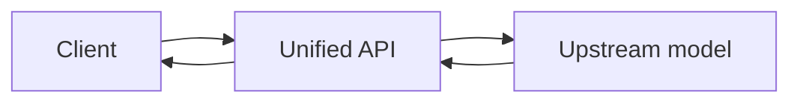

# Service overview

The unified model service provides an OpenAI-compatible HTTP API for accessing models from different upstream providers through one interface.

## Before you begin

Keep your access token secure. Do not include it in public repositories or client-side applications. Refer to Model Square for availability and pricing.

## Request flow



## Video example

```video
../media/video-example.mp4
```

## Service features

- One request format
- Centralized authentication
- Multiple model options
- Standardized error responses
