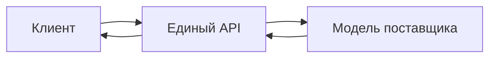

# Обзор сервиса

Единый сервис доступа к моделям предоставляет HTTP API, совместимый с OpenAI, и позволяет обращаться к моделям разных поставщиков через единый интерфейс.

## Перед началом работы

Храните токен доступа в безопасности. Не добавляйте его в общедоступные репозитории или клиентские приложения. Сведения о доступности и стоимости моделей приведены в разделе «Витрина моделей».

## Схема запроса



## Пример видео

```video
../media/video-example.mp4
```

## Возможности сервиса

- Единый формат запросов
- Централизованная аутентификация
- Выбор из нескольких моделей
- Стандартизированные ответы об ошибках
