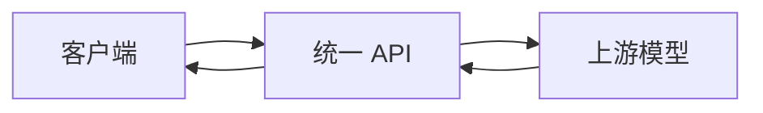

# 服务介绍

统一模型服务提供兼容 OpenAI 的 HTTP API，可通过同一套访问方式调用不同上游模型。

## 开始之前

请妥善保管访问令牌，不要将其写入公开代码仓库或客户端应用。可用模型和计费信息以模型广场展示的内容为准。

## 请求流程



## 视频示例

```video
../media/video-example.mp4
```

## 服务特点

- 统一的请求格式
- 统一的身份验证
- 多种模型选择
- 标准化的错误响应
