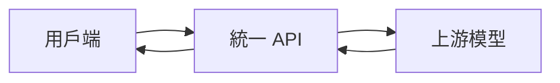

# 服務介紹

統一模型服務提供與 OpenAI 相容的 HTTP API，讓您透過同一套存取方式呼叫不同的上游模型。

## 開始之前

請妥善保管存取權杖，不要將其寫入公開的原始碼儲存庫或用戶端應用程式。可用模型與計費資訊請以模型廣場顯示的內容為準。

## 請求流程



## 影片範例

```video
../media/video-example.mp4
```

## 服務特色

- 統一的請求格式
- 統一的身分驗證
- 多種模型選擇
- 標準化的錯誤回應
